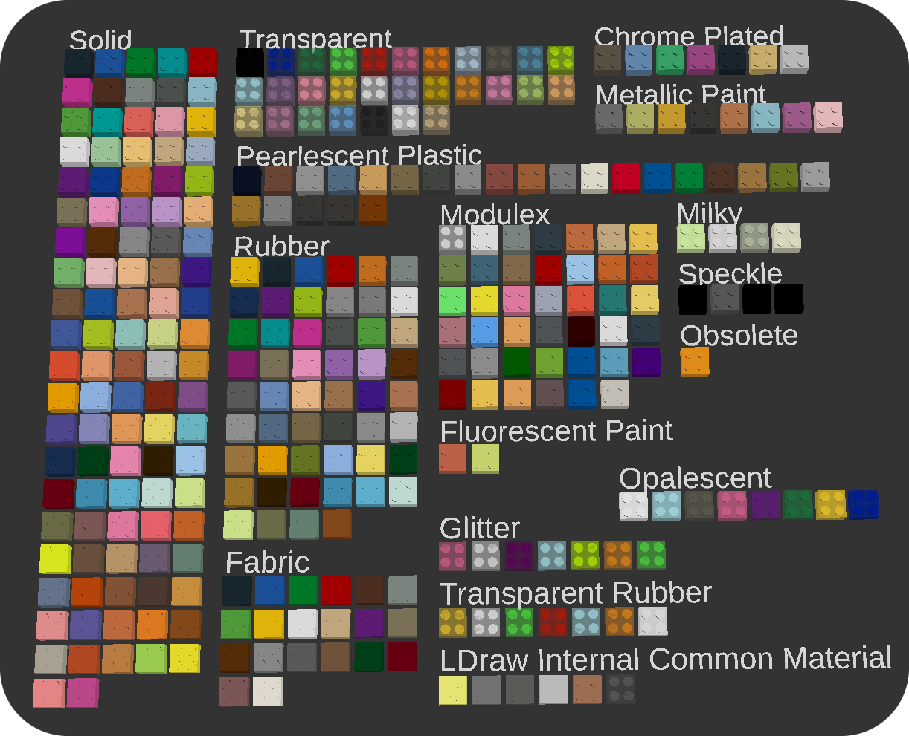

This is a library for OpenScad that lets you use the LDraw colour codes and names.


## Installation
1. Download the latest library zip [library.zip](https://github.com/Nexusnui/LDrawColoursForOpenScad/releases/latest/download/library.zip)
2. Unpack it
3. Move the ldraw-colours folder into your OpenScad library or project folder  
(This library might be also be installable through the OpenScad library manager, when available)  
## Usage

### With Variable Names
Include:  
`include <ldraw-colours/colours.scad>;`  
Then you can use ldraw colours like this:  
`color(LD_Red)sphere(10);`  
There are two prefixes "LD_" and "LDe_". They followed by either a colour code or name.
For example "LD_4" and "LD_Red" are the same colour. Colour names are the same as in the LDraw LDConfig.ldr file (each word uppercase and seperated with "_").
The prefix "LDe" returns the edge colour of the LDraw colour.  
More about LDraw colours can be found in the [LDraw Colour Definition Reference](https://www.ldraw.org/article/547.html).

### With a Function
Include:
`use <ldraw-colours/utils.scad>;`  
Then apply a colour to an object like this:
```
ldraw_color(4)sphere(10);` 
```
To apply the edge colour:
```
ldraw_color("Red", edge=true)sphere(10);` 
```
The function accepts either a colour code(string or int) or a colour name(string). Colour names are the same as in the LDraw LDConfig.ldr file (each word uppercase and seperated with "_").
Applying the colour through a function can be useful when using the OpenScad customizer.

The colour values are from the LDConfig.ldr file included with the LDraw library available on [LDraw.org](https://ldraw.org)  
The colours are the ones present in the parts update 2025-09.  
LDraw™ is a trademark owned and licensed by the Estate of James Jessiman, which does not sponsor, endorse, or authorize this library.